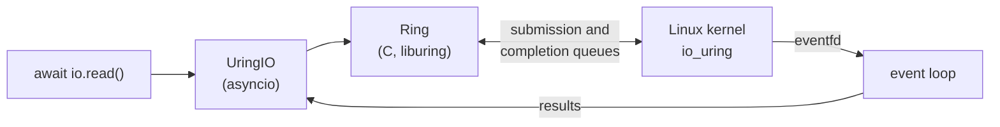

pyaio: asynchronous file I/O for Python on Linux
===============================================

pyaio gives asyncio programs file reads, writes and fsyncs that don't block
the event loop. It is backed by **io_uring** and falls back to a thread pool
where io_uring isn't available. It also still ships the original callback API
on glibc POSIX AIO.

> [!WARNING]
> **Learning project, alpha quality.** pyaio is a small, readable example of
> integrating io_uring with asyncio. It has not been audited, has only been
> tested on a recent kernel, and its API may change.
>
> **io_uring has a long record of kernel security vulnerabilities.** Many
> container runtimes and hardened systems disable it, and it can hide I/O from
> syscall-based security monitoring. Read [SECURITY.md](SECURITY.md) before
> enabling it on a machine you share or care about.



How it works, with diagrams: [docs/architecture.md](docs/architecture.md).

Requirements
------------

* Linux, CPython 3.10+
* For the io_uring backend: kernel 5.6+. Building from source also needs the
  liburing headers (2.2 or newer: `liburing-dev` on Debian/Ubuntu 24.04+,
  `liburing-devel` on Fedora, `liburing` on Arch). Without liburing the
  package still builds, with only the fallback.

Install
-------

```sh
pip install --pre pyaio      # release candidates need --pre
```

Wheels for x86_64 and aarch64 bundle liburing, so nothing else is needed.
To build from source instead, install the liburing headers first
(`tools/install-liburing.sh` builds the pinned version) and run
`pip install .`.

Quick start
-----------

```python
import asyncio
import os

from pyaio.uring import open_io

async def main():
    fd = os.open('/tmp/pyaio.txt', os.O_RDWR | os.O_CREAT, 0o644)
    async with open_io() as io:
        print('backend:', io.backend)            # 'io_uring' or 'threads'
        await io.write_all(fd, b'hello io_uring', 0)
        await io.fsync(fd)
        data = await io.read(fd, 0, 5)           # bytearray(b'hello')
        chunks = await asyncio.gather(           # one syscall for all four
            *[io.read(fd, off, 4) for off in range(0, 16, 4)])
    os.close(fd)

asyncio.run(main())
```

API
---

`open_io(entries=256, max_inflight=None)` returns a `UringIO`, or a `ThreadIO`
if io_uring is unavailable (this is logged as a warning). Both have the same
interface:

| Method | Result |
|---|---|
| `await io.read(fd, offset, nbytes)` | `bytearray`; shorter than `nbytes` at end of file, empty past it |
| `await io.write(fd, data, offset)` | bytes written, which **can be short** like `os.pwrite` |
| `await io.write_all(fd, data, offset)` | `len(data)`; retries short writes |
| `await io.fsync(fd, datasync=False)` | `0` |
| `await io.aclose(timeout=None)` | cancels outstanding work without blocking the loop |
| `io.close(timeout=None)` | the same, blocking the calling thread |
| `io.backend`, `io.inflight`, `io.queued`, `io.closed` | introspection |

* `offset=-1` means "current file position". Concurrent requests that use it
  run in no guaranteed order.
* Errors raise the matching `OSError` subclass (`FileNotFoundError`,
  `IsADirectoryError`, `BrokenPipeError`, ...).
* **Cancelling** the awaiting task cancels the kernel request. Pipes and
  sockets stop immediately; reads and writes on regular files the kernel has
  already started usually finish anyway, and their result is discarded.
* **Backpressure:** at most `max_inflight` requests (default `2 * entries`)
  are handed to the kernel at once. The rest wait in a queue without
  allocating buffers.
* **Close timeouts:** if requests are still running when the timeout expires,
  pyaio abandons them. Their futures fail with `ECANCELED`, their buffers are
  leaked rather than freed (freeing memory the kernel may still write to
  would corrupt memory), and a `ResourceWarning` is emitted.
* Call a `UringIO` only from its event loop's thread, and don't use it in a
  child process after `fork()` (create a new one there).

Limitations
-----------

* Only `read`, `write` and `fsync`. No `open`/`stat`/`close`, vectored I/O,
  registered buffers or `O_DIRECT` aligned buffers.
* Kernel cancellation cannot interrupt disk I/O already in progress, so a
  close on a hung network filesystem waits until its timeout.
* The C extension relies on the GIL. On free-threaded Python builds the GIL
  is re-enabled when pyaio is imported.
* Tested only on Linux 7.2, Python 3.14 and liburing 2.15.

Legacy POSIX AIO API
--------------------

The original callback API is still available. It uses glibc's POSIX AIO,
which runs blocking I/O on a user-space thread pool (see the
[comparison](docs/architecture.md#8-the-legacy-posix-aio-path)). It is
loaded only when first used.

```python
import os
import time

import pyaio

def on_read(buf, rcode, errno):
    if rcode > 0:
        print('read', bytes(buf))
    elif rcode == 0:
        print('EOF')
    else:
        print('error', errno)

def on_write(rcode, errno):
    print('wrote', rcode) if rcode >= 0 else print('error', errno)

fd = os.open('/tmp/pyaio.txt', os.O_RDWR)
pyaio.aio_read(fd, 0, 20, on_read)               # fd, offset, length, callback
pyaio.aio_write(fd, b'data', 30, on_write)       # fd, buffer, offset, callback
time.sleep(0.1)  # callbacks run on the main thread while it executes Python
```

Wait for callbacks before queuing many more requests in a tight loop, or
pyaio may stall when glibc's AIO queue is full. Tune the pool with
`pyaio.aio_init(max_threads, max_queue_size, max_thread_idle_seconds)`. pyaio
uses `5 * cores` threads and `4 * threads` queue entries when that is more
than glibc's default of 20 threads and 64 entries. An exception raised in a
callback is reported through `sys.unraisablehook`.

Development
-----------

```sh
python -m venv .venv && . .venv/bin/activate
pip install setuptools pytest
python setup.py build_ext --inplace
python -m pytest
```

Set `PYAIO_REQUIRE_URING=1` to make the suite fail when io_uring is not
usable instead of skipping those tests.

See [CHANGELOG.md](CHANGELOG.md) for release notes and
[RELEASING.md](RELEASING.md) for the release process.

License
-------

BSD-3-Clause. See [LICENSE](LICENSE).
