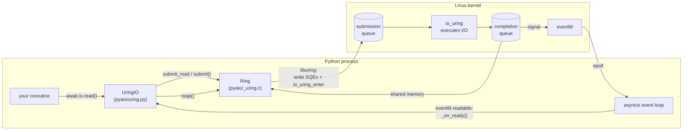
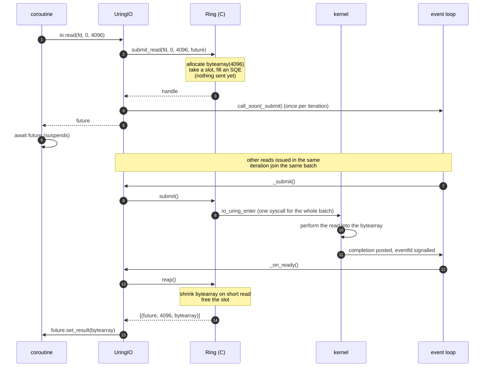
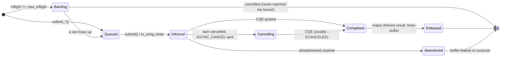
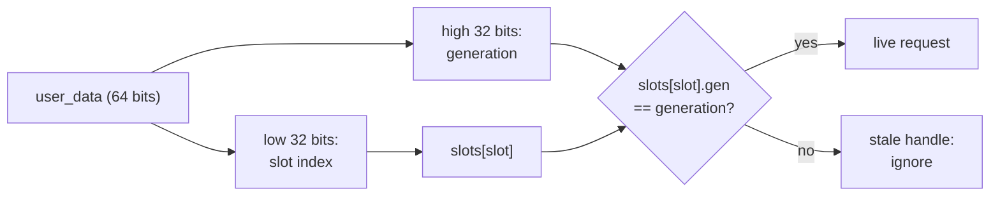
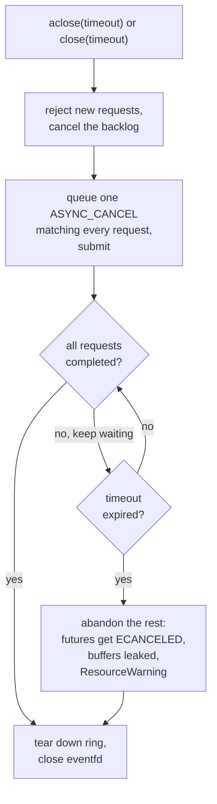
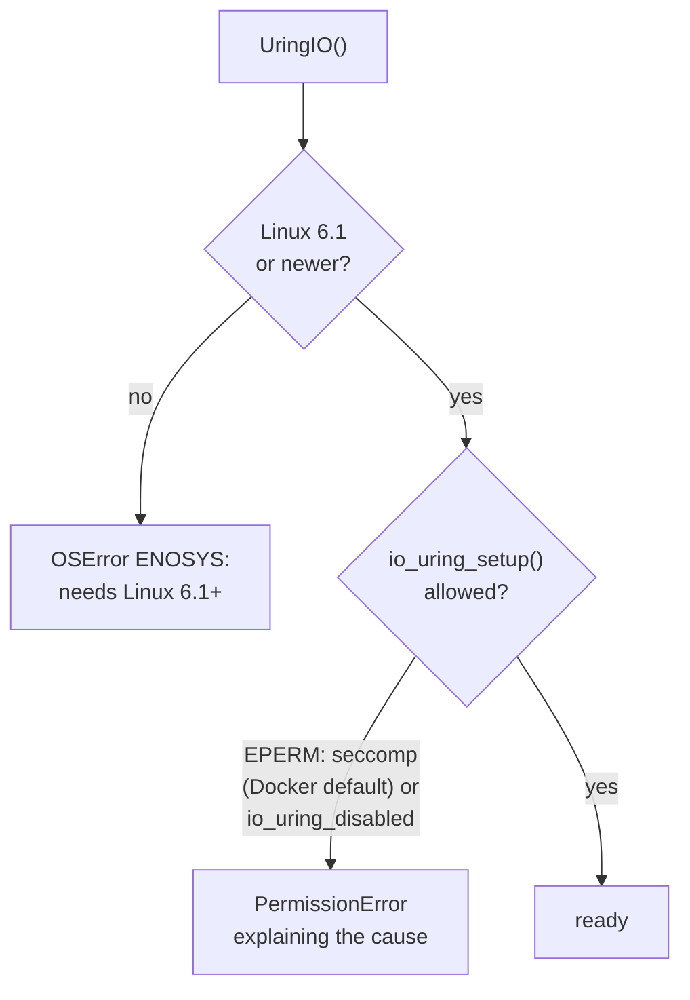
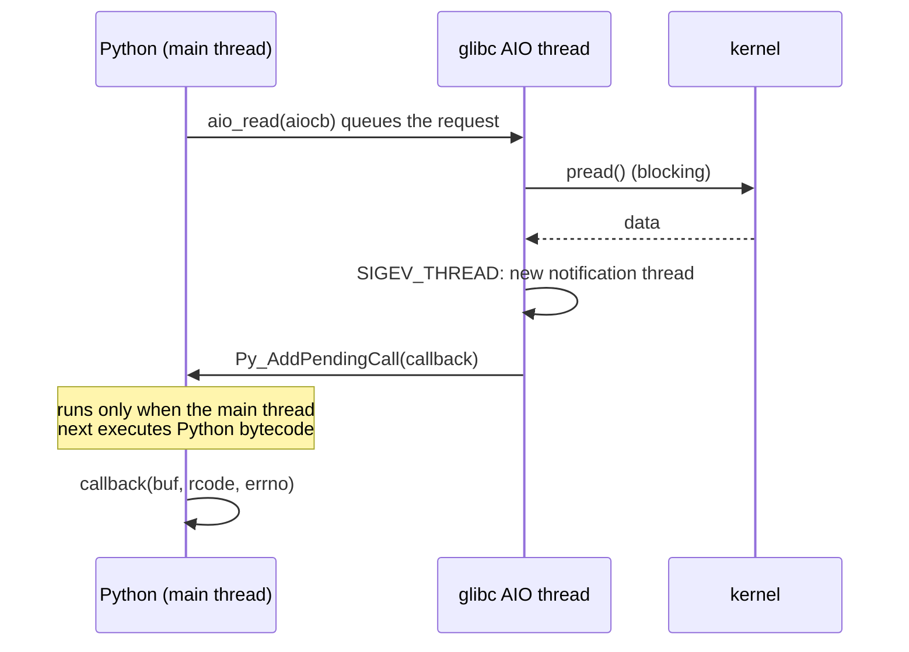

# How pyaio works

pyaio has two independent backends:

| | `pyaio.uring` (new) | `pyaio.aio_read` / `aio_write` (legacy) |
|---|---|---|
| Kernel interface | io_uring (Linux 6.1+) | glibc POSIX AIO (`aio.h`) |
| Who does the I/O | the kernel, asynchronously | a glibc **user-space thread pool** running blocking `pread`/`pwrite` |
| API style | asyncio futures | callbacks |
| Batching | one syscall per loop iteration | one request at a time |
| Cancellation | yes, through the kernel | no |

Most of this document is about the io_uring backend. The legacy path is
summarised at the end for comparison.

## 1. The moving parts

* **`Ring`** (C) owns one io_uring instance and one eventfd. It knows nothing
  about asyncio: it queues requests, submits them, and returns finished ones
  as `(token, result, payload)` tuples. The token is any Python object; the
  asyncio layer uses the request's future.
* **`UringIO`** (Python) binds a ring to one event loop. It turns calls into
  futures, batches submissions, enforces backpressure and handles shutdown.
* The **eventfd** is the bridge between the two: the kernel bumps it whenever
  a completion is posted, and the loop watches it with `add_reader`, the same
  way it watches a socket. Results are therefore always delivered on the loop
  thread with no locks, threads or signals involved.

## 2. Life of a read

The bytearray is created in C and is not visible to Python until `reap()`
returns it, so nothing can resize or free it while the kernel is writing into
it. For writes, the caller's buffer is *pinned* with the buffer protocol
(`PyObject_GetBuffer`). A pinned `bytearray` refuses to resize
(`BufferError`) until the write completes.

## 3. Request states

* **Backlog** is a plain Python deque in `UringIO`. Requests there have no
  buffer yet, so a burst of a million reads does not allocate a million
  buffers. `max_inflight` defaults to the completion queue size, which also
  keeps the kernel from overflowing it.
* **Cancelling** a request on a pipe or socket stops it immediately. Reads
  and writes on regular files that the kernel has already started generally
  run to completion; the result is simply discarded.
* **Abandoned** only happens when a close timeout expires. The kernel might
  still write into the buffer, so pyaio never frees it: the memory is leaked
  and a `ResourceWarning` is emitted. A leak is a bug you can see; a
  use-after-free is memory corruption you cannot.

## 4. Handles: why not just use pointers?

Each in-flight request lives in a slot table. The 64-bit `user_data` the
kernel carries for each request is a handle, not a memory address:

asyncio runs a task's cancellation one loop iteration *after* `cancel()` is
called. In between, the request may finish, its memory may be freed, and a
new request may land at the same address. Cancelling "by pointer" would then
cancel the wrong request. With a generation number, a stale handle can never
match the new occupant of its slot. `user_data == 0` is reserved for pyaio's
internal cancel requests.

## 5. Shutting down

* `aclose()` waits on the event loop, so other tasks keep running.
  `close()` blocks the calling thread; use it from synchronous code.
* A single `IORING_ASYNC_CANCEL_ANY` request cancels everything at once.
* If the `Ring` is garbage collected while requests are still in flight, it
  runs the same procedure with a 1 second limit.

## 6. When things go wrong

| Failure | What pyaio does |
|---|---|
| Kernel older than 6.1 | `UringIO()` raises `OSError(ENOSYS)` naming the running kernel |
| io_uring blocked by seccomp or `kernel.io_uring_disabled` | `UringIO()` raises `PermissionError` naming the likely causes |
| `submit()` fails with `EAGAIN`/`EBUSY`/`EINTR` | retries on the next loop iteration |
| `submit()` fails with anything else | the ring is closed and **every** pending future fails with that error, so nothing hangs |
| Out of memory while reaping | the completion stays in the kernel's queue, the eventfd is re-armed, and the next iteration retries |
| Request fails in the kernel | the future raises the matching `OSError` subclass (`FileNotFoundError`, `BrokenPipeError`, ...) |
| `UringIO` called from another thread | `RuntimeError` |
| `Ring` used in a child after `fork()` | `RuntimeError`; the child never touches the parent's queues |

## 7. Where it runs

There is deliberately no fallback. Supporting environments where io_uring
is usually unavailable would mean a second implementation to maintain and
test, for places pyaio is not meant for.

## 8. The legacy POSIX AIO path

> **Deprecated since 0.5, removed in 0.6.** Kept here for comparison.

For comparison, this is what `pyaio.aio_read` does. glibc implements POSIX
AIO in user space: a pool of threads performs ordinary blocking calls.

This is why the README says to tune `aio_init(threads, ...)`: the thread pool
*is* the asynchrony. io_uring removes the threads, the per-request
notification thread and the pending-call hop.

## Source map

| File | Role |
|---|---|
| `pyaio/_uring.c` | `Ring`: slot table, SQE/CQE handling, cancellation, shutdown, fork detection, kernel check |
| `pyaio/uring.py` | `UringIO`: asyncio integration |
| `pyaio/core.c` | legacy POSIX AIO bindings (deprecated, removed in 0.6) |
| `pyaio/__init__.py` | version, lazy loading of the legacy API |
| `tests/test_uring.py` | io_uring tests, including the failure modes above |
| `tests/test_pyaio.py` | legacy API tests |
| `tools/install-liburing.sh` | builds the pinned liburing for CI and wheels |
| `tools/ci-pytest.sh` | runs pytest in CI and reports results as GitHub annotations |
| `.github/workflows/` | CI (`ci.yml`) and wheel builds and publishing (`release.yml`) |
